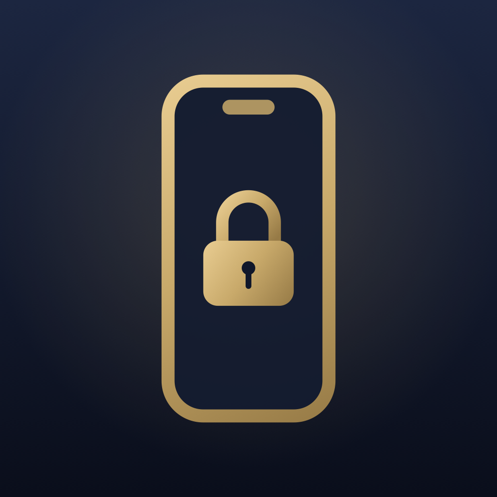
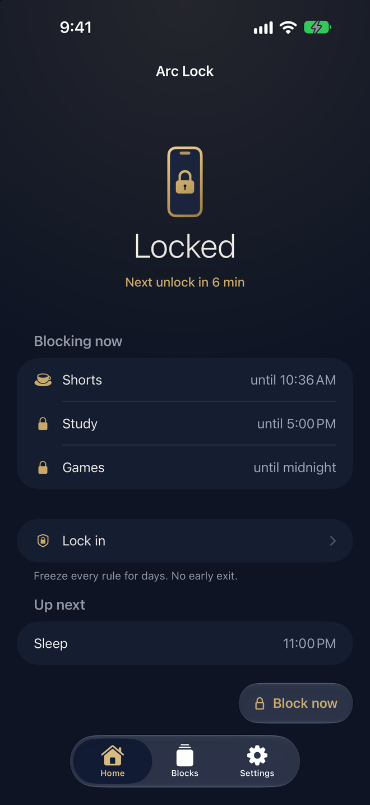
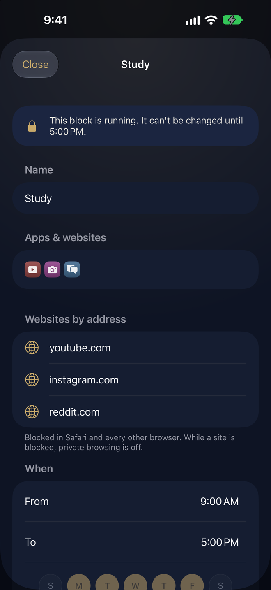
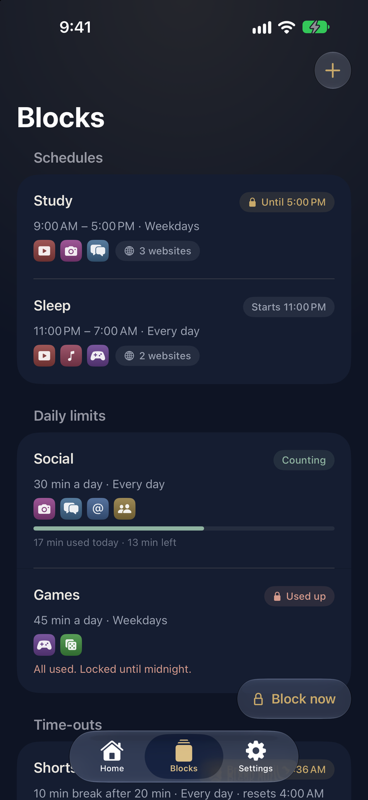
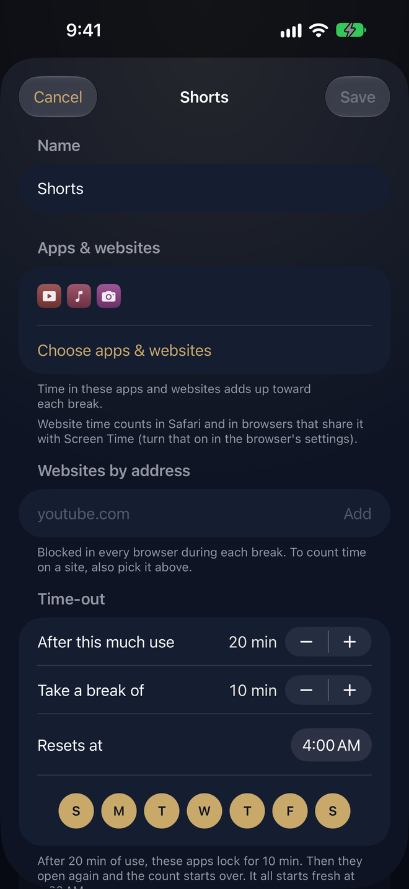
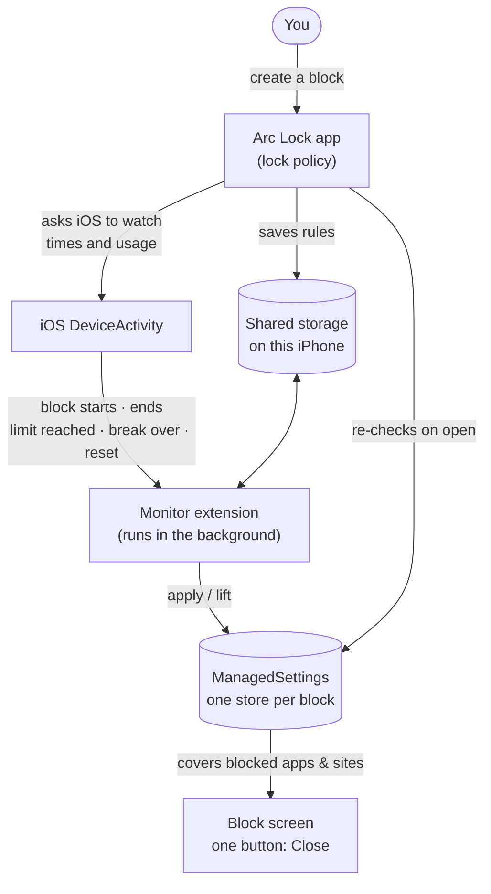

<p align="center"></p>

<h1 align="center">Arc Lock</h1>
<p align="center">Companies fight for every second of your time to keep you distracted.<br>
<b>Taking control of your screen time should be a human right,<br>not something locked behind a paywall.</b></p>

<p align="center">So Arc Lock gives everyone the strict blocker other apps charge for. A free, open-source app and website blocker for iPhone — schedules, daily limits, time-outs, and a lock you can't talk your way out of.</p>

<p align="center">Free · No account · No ads · No tracking · MIT licensed</p>

<p align="center"><a href="https://apps.apple.com/app/arc-lock-app-blocker/id6822023409"><b>Get Arc Lock on the App Store</b></a></p>

---

Most blockers keep their "hard mode" — the part that actually stops you — behind a subscription. Arc Lock gives it away. You choose the apps and websites, choose when they lock, and once a block with **Strict lock** is running **nothing in the app can stop it early, no app can be deleted, and the clock can't be set back.**

<p align="center">
  
  
  
  
</p>

## What it does

- **Schedules** — lock apps, app categories and websites during set hours on the days you pick (up to 22 hours; overnight windows like 23:00 → 07:00 work too).
- **Daily limits** — after the time you allow (5 min – 8 h), the apps lock until the limit resets — at midnight, or at the time you pick (say 4:00 AM, for late nights). Each limit shows exactly how many minutes are used and left. A heads-up comes 5 minutes before.
- **Time-outs** — not a full block, a pause: after a stretch of use (5 min – 4 h) the apps take a break (1 min – 2 h), then open again. Repeats all day, and starts fresh at its reset time.
- **Block now** — lock something right away for 15 minutes to 12 hours.
- **Places** — pick a place on the map (library, school, gym) and the apps lock when you arrive. Each place block ends when you leave, or after a set time — your choice — and only starts on the days you pick. Location access is asked for only when you set up a place block, and Arc Lock never sends your location anywhere.
- **Names are optional** — a block without a name is shown by its first app (iOS draws the name; Arc Lock never learns it).
- **Websites by address** — type `youtube.com` and it's blocked in Safari, Chrome, Brave and every other browser — in schedules, daily limits, time-outs and Block now. (Websites picked in Apple's picker are counted and blocked in Safari, and counted in browsers that share their pages with Screen Time — in Brave, turn on *Settings › Shields & Privacy › Enable Screen Time*.)
- **Native and in reach** — Apple's own lists and compact Liquid Glass tab bar (Home · Blocks · Settings), with **Block now** as a small glass button floating just above it.
- **Themes and app icons** — five looks (Navy, Graphite, Forest, Plum, Paper), each with a matching app icon. The phone-and-lock mark in the app closes while something is blocked and opens when nothing is.
- **Strict lock** — on by default, and set per block. While a strict block runs:
  - it can't be edited, stopped or deleted in Arc Lock,
  - **no app can be deleted** from the iPhone (Arc Lock included),
  - the date and time can't be changed by hand (they stay automatic as long as any strict block is switched on),
  - the block screen has exactly one button: **Close**.

  A block without Strict lock can be stopped or changed any time. Strict lock can also be switched off for the whole app in Settings. That works right away, but it never frees a block early: one that's running or counting stays strict until its own reset, or until it ends.
- **Daily limits and time-outs are locked in until they reset** — you can make one stricter once a day (what you've already used keeps counting); more time, a shorter break, fewer apps, deleting it or a second change only take effect at its next reset (midnight, or the time you picked).
- **Deletion protection** — on by default: no app can be deleted from the iPhone, Arc Lock included. Switching it off waits until the strict blocks running or counting at that moment have reset or ended (right away if there are none).
- **Lock-in** — freeze every rule for 1–30 days, even between blocks. No loosening, no deleting rules, no deleting apps — and changes you queued before it wait until it's over. No early exit.

## How it works

Arc Lock is built entirely on Apple's **Screen Time API** — three frameworks that let an app restrict its own user's device with their permission:

| Framework | What Arc Lock uses it for |
|---|---|
| **FamilyControls** | Asking for permission (`AuthorizationCenter.requestAuthorization(for: .individual)` — Face ID, no account) and the system app picker. The picker returns **opaque tokens**: Arc Lock can show an app's icon and name but can never read *which* apps you chose. |
| **ManagedSettings** | The actual locking: `shield` covers apps and websites with the block screen; `webContent.blockedByFilter` blocks typed web addresses in every browser; `application.denyAppRemoval` stops app deletion; `dateAndTime.requireAutomaticDateAndTime` stops clock tricks. |
| **DeviceActivity** | Waking Arc Lock up in the background: when a schedule starts or ends, when a limit's usage passes a threshold, when a break ends, and at each block's reset — even if Arc Lock hasn't been opened for days. Its `DeviceActivityReport` extension draws the minutes used today inside the app. |
| **CoreLocation** (place blocks only) | Region monitoring: iOS watches the circle around each chosen place and relaunches Arc Lock in the background when you cross its edge, so a place block starts on arrival and ends on leaving. Each running place block also gets a one-off DeviceActivity monitor that lifts it at its set time — or, for one that ends when you leave, at its 12-hour safety end — even if Arc Lock stays closed. Asked for only when a place block is set up; Arc Lock never sends the location anywhere (the map and place search use Apple Maps). |



### Five parts

1. **The app** (`App/`) — where you create blocks. Every change goes through one lock policy (below) before it's saved.
2. **The monitor extension** (`Extensions/Monitor`) — a `DeviceActivityMonitor` that iOS runs in the background. Each schedule or limit is one monitored activity:
   - a **schedule** is a repeating daily interval (e.g. 09:00–17:00); the extension shields when it starts and lifts the shield when it ends. Weekdays are checked in the extension, so one activity covers every day of the week.
   - a **daily limit** is a day-long interval — from its reset time to a minute before the next (00:00–23:59 by default) — with usage **events** at every tenth of the allowed time. The 100 % event shields the apps; the others drive the progress bar (iOS reports thresholds, never minutes). A new limit starts counting when it's saved, then from every reset — midnight, or the time picked for it (`includesPastActivity: false`). When a limit is made stricter mid-day, iOS restarts its count, so Arc Lock registers only what's left — today's use, as far as the tenths prove it, carries over. Because that carry-over rounds down to a tenth, only one such restart is allowed per limit per period; later changes wait for its next reset.
   - **Guarding against false locks:** iOS sometimes reports a threshold too early (a known issue on iOS 26–27). Time used can't outrun the clock, so a threshold that couldn't have been reached yet is ignored (`Plausibility` in Core) and the limit is re-armed with what's provably used (at most 3 times a day). That stops the common glitch — right after registering — from locking you out; a misreport later in the day can't be told apart from real use.
   - a **time-out** is an all-day interval with one usage event at the allowed stretch. When it fires, the extension shields the apps and starts a one-off activity that ends with the break; its end lifts the shield and re-registers the usage event, so counting starts over. (iOS wants activities of at least 15 minutes, so a short break's activity starts in the past.)
   - a **daily housekeeping** activity at midnight ends expired lock-ins; each limit's or time-out's own monitor applies its waiting changes when it resets.
3. **The block screen** (`Extensions/ShieldConfig`) — what iOS shows over a blocked app: which block holds it and when it ends.
4. **The block screen's button** (`Extensions/ShieldAction`) — always answers `.close`. There is no "5 more minutes". Pressing it also re-checks the rules, so a block whose time is up lifts even if a callback was missed.
5. **The usage line** (`Extensions/Report`) — a `DeviceActivityReport` extension. iOS hands Screen Time minutes only to this sandboxed extension, which draws "17 min used today · 13 min left" inside the app; Arc Lock itself never sees the numbers.

### One store per rule

Each rule writes to its **own named `ManagedSettingsStore`**. iOS combines all stores and keeps the strictest value, so overlapping blocks never undo each other, and ending one block simply clears its store. Every store that shields something for a strict block also sets `denyAppRemoval` and `requireAutomaticDateAndTime`; those disappear with it when the block ends.

iOS allows an app 20 monitored activities and 50 named stores, so Arc Lock keeps up to 18 blocks (a time-out needs two activities: its usage and its break) and gives each one a slot from a fixed pool (`slot.0`…`slot.17`, plus `session`, `lockin` and `clock`) that is reused after a block is deleted. A shield set with more than 50 items silently blocks nothing, so each block takes at most 49 apps and 49 picked websites (whole categories have no limit).

The `clock` store keeps the date and time automatic whenever any strict block is switched on, so the clock can't be moved past a block — or past a change that's waiting for its reset.

### Rules are the source of truth

Background callbacks can be late, early or missed (the phone was off, iOS was busy). So nothing depends on a single callback: `Engine.reconcile` recomputes from the rules what *should* be blocked right now and makes the stores match. The app runs it whenever it opens, the extension after every callback. A missed callback heals itself.

### The lock policy

All of it lives in [`Core/ArcCore.swift`](Core/ArcCore.swift) — plain Swift with no Apple frameworks, unit-tested on a Mac:

| Rule is… | You can… |
|---|---|
| a **running** schedule, a **used-up** limit, a time-out **on a break**, or a **Block now** session — with Strict lock | look, not touch — until it ends |
| a **daily limit or time-out counting** — with Strict lock | make it stricter now, once per reset (the use so far keeps counting); anything else — more time, a shorter break, fewer apps or days, a new reset time, deleting, a second change — waits for its next reset |
| any block **without Strict lock** (or with Strict lock switched off in Settings — a block that was running or counting then stays strict until its own reset, or until it ends) | change it, stop it or delete it any time |
| anything during a **lock-in** | add new blocks; existing ones are frozen, strict or not, and changes queued earlier wait until it ends |
| a schedule **between windows** | change anything — a schedule lasts at most 22 hours, and all schedules together must leave a free hour every day, so there's always such a time (and Arc Lock can always be opened, even if a block includes it) |

"Stricter" is computed, not guessed: more apps, more days, fewer minutes, a longer break, Strict lock switched on, or a time window that covers the old one.

## Privacy

Arc Lock collects nothing. No account, no server, no analytics. Rules and Apple's opaque tokens stay in the app's storage on your iPhone. See [PRIVACY.md](PRIVACY.md).

## Build it yourself

You need a Mac with **Xcode 26.5 or later** (built with Xcode 27), an iPhone on **iOS 18 or later** (the Screen Time API doesn't block anything in the Simulator) and an Apple developer account.

```bash
brew install xcodegen
git clone https://github.com/WeldingArc/arc-lock.git
cd arc-lock
xcodegen generate
open ArcLock.xcodeproj
```

Set your own team and bundle-ID prefix in `project.yml` (five targets, one App Group), then run on your iPhone. The **Family Controls (Development)** capability works for any team; shipping to TestFlight or the App Store needs Apple to approve the **Family Controls (Distribution)** entitlement for every bundle ID (the app and its four extensions).

Core logic tests run on the Mac:

```bash
mkdir -p build
swiftc -parse-as-library Core/ArcCore.swift Tests/CoreTests.swift -o build/coretests && build/coretests
```

Debug builds have a screenshot mode with sample data (no Screen Time calls): launch with `-demo YES -shot home` (or `editor`, `limit`, `timeout`, `timeouts`, `blocknow`, `settings`, `appearance`, `lockin`, `guide`, `onboarding`); add `-theme graphite` (or `forest`, `plum`, `paper`) for another theme.

### Layout

```
Core/ArcCore.swift          lock policy, time math, validation (no Apple frameworks; unit-tested)
Shared/                     state in the App Group, shields, monitors, reconcile (app + extensions)
App/                        SwiftUI app, theme, demo mode
Extensions/Monitor          DeviceActivityMonitor: schedules, limits, time-outs, midnight housekeeping
Extensions/ShieldConfig     the block screen
Extensions/ShieldAction     the block screen's only button
Extensions/Report           DeviceActivityReport: minutes used today, drawn inside the app
Tests/CoreTests.swift       Mac-runnable tests for Core
tools/make_phone_icon.swift renders the app icons and block-screen marks for every theme
Shared/Themes.swift         the five themes (shared with the block screen and the usage line)
```

## License

[MIT](LICENSE). The bundled [Pretendard](https://github.com/orioncactus/pretendard) font is under the [SIL Open Font License](licenses/Pretendard-OFL.txt).

Made by [WeldingArc](https://github.com/WeldingArc) — also behind [Arc Lecture Transcriber](https://github.com/WeldingArc/arc-lecture-transcriber).
